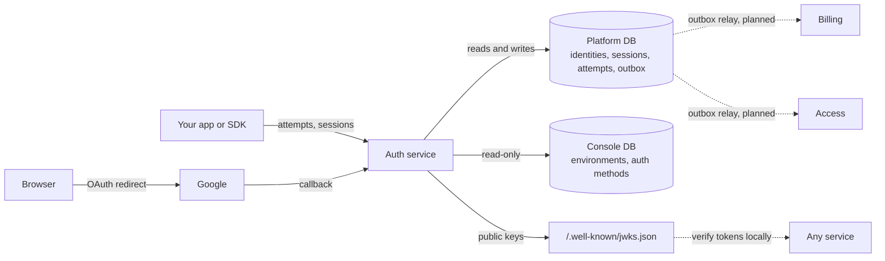
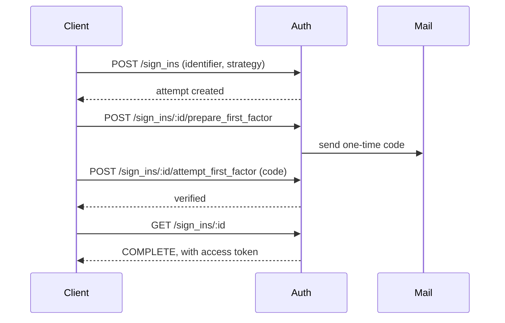

<h1 align="center">Shipstack Platform</h1>

Multi-tenant SaaS infrastructure: authentication, feature access, and billing, built as separate services that share tenant environments.

This monorepo starts with **Auth**, a complete sign-in and session service. Access and Billing are planned.

## Auth

Shipstack Auth handles sign-up, sign-in, sessions, and token verification for applications with many tenants. Each tenant gets isolated environments, and every auth method goes through the same attempt model.

- **Sign-in and sign-up as attempts.** Each flow moves through explicit states (`NEEDS_IDENTIFIER`, `NEEDS_FIRST_FACTOR`, `COMPLETE`, and others), modeled on Clerk's approach. A new auth method adds a strategy, not a new set of endpoints.
- **Methods.** Email and password (with optional verification and a leaked-password check), one-time email codes, and Google OAuth with PKCE and state checks.
- **Sessions and tokens.** Access tokens are RS256 JWTs, verified against a public JWKS endpoint, so any service can check a session without calling Auth. Sessions rotate their tokens and expire independently of the token.
- **Environments.** Each project has a development and a production environment, each with its own keys. Public keys use `pk_test_` for development and `pk_live_` for production.

### Overview



### Email-code sign-in



### How a sign-in works

```text
POST /api/v1/auth/client/sign_ins                            -> NEEDS_FIRST_FACTOR, or COMPLETE for password
POST /api/v1/auth/client/sign_ins/:id/prepare_first_factor   -> sends the code, or returns the OAuth URL
POST /api/v1/auth/client/sign_ins/:id/attempt_first_factor   -> submits the code
GET  /api/v1/auth/client/sign_ins/:id                        -> COMPLETE, with an access token
```

Google sign-in uses the same attempt. The provider redirects to `/api/v1/auth/oauth_callback`, which completes the exchange and hands off to the tenant's own domain with a short-lived handshake token. The app redeems that token to set its session cookies.

### Client identity

Each browser has a **client** with a rotating token. The server resolves it from one of three sources, never from the request body:

- the `__client` cookie (direct mode),
- a signed `x-shipstack-client` header (backend-proxy mode), or
- a `__shipstack_db_jwt` pointer (development only).

### Architecture

```text
apps/auth/
  src/modules/auth/     attempts, sessions, OAuth, password and verification flows
  src/core/             identity tokens, encryption, mail, database, outbox
  src/common/           guards, client resolution, error envelopes
  prisma/platform.prisma    Auth-owned tables
  prisma/console.prisma     read model of tenant configuration (read-only)
  e2e/                  end-to-end suite
```

Auth owns its tables and reads tenant configuration through a read-only connection. It doesn't write to plans, quotas, or subscriptions, which belong to Billing and Access. State changes publish events through a transactional outbox, so an event exists if and only if the change committed.

## Running locally

Requirements: Node 20+, pnpm, and Docker.

```bash
pnpm install
cd apps/auth
cp .env.example .env          # fill in ENCRYPTION_KEY and CLIENT_COOKIE_SECRET
pnpm prisma:generate
pnpm start:dev                # http://localhost:9001, Swagger at /api/v1/docs
```

Without `SMTP_HOST`, emails are written to the log.

## Testing

```bash
cd apps/auth
pnpm test                     # unit tests
pnpm test:db                  # start a throwaway Postgres on :5433 and load the schemas
cp e2e/.env.test.example e2e/.env.test
pnpm test:e2e                 # end-to-end tests against a real database
```

The end-to-end suite runs the app over HTTP against Postgres. It covers sign-up and sign-in, email codes, Google OAuth (with the provider mocked), sessions and token expiry, backend-proxy authentication, and error responses.

## Status and limits

| Area | Status |
| :--- | :--- |
| Auth: email and password, email code, Google OAuth | Available |
| Sessions, token rotation, JWKS | Available |
| Development-only dev-browser flow | Available |
| Magic link, passkeys, MFA | Planned |
| Event delivery from the outbox | Planned |
| Access (features, quotas, usage) | Planned |
| Billing (plans, subscriptions) | Planned |
| Framework SDKs | Planned |

Rate limiting is not included yet. Add it before running Auth in production.

## Documentation

- [`docs/auth-contract.md`](docs/auth-contract.md): routes, attempt states, client identity, and token contract.

## License

To be added.
